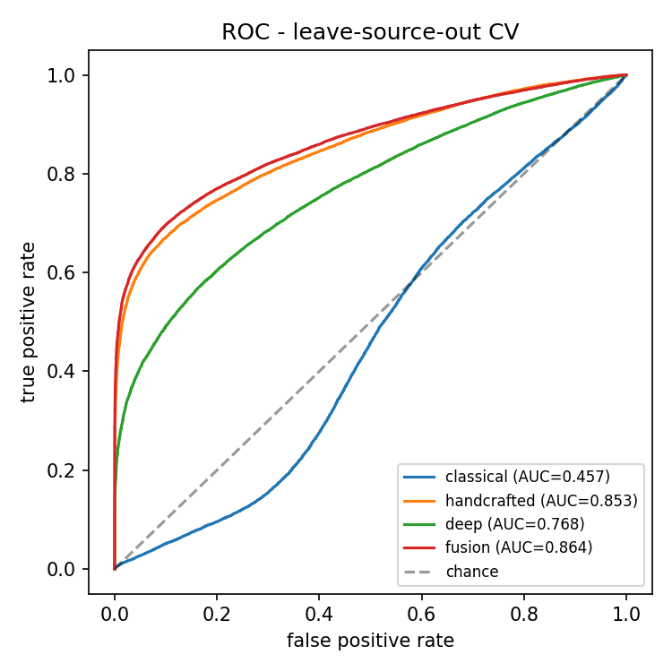
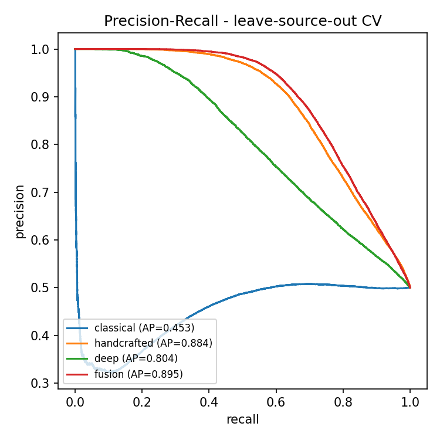
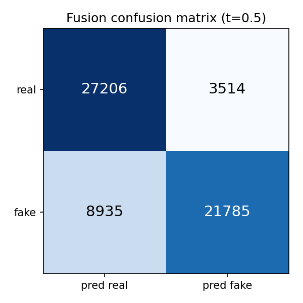
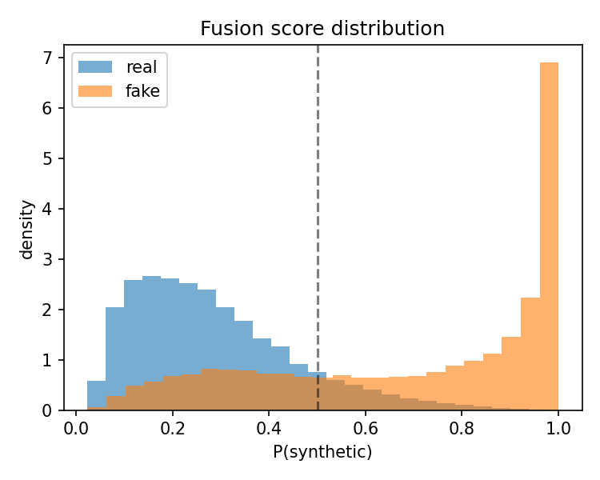
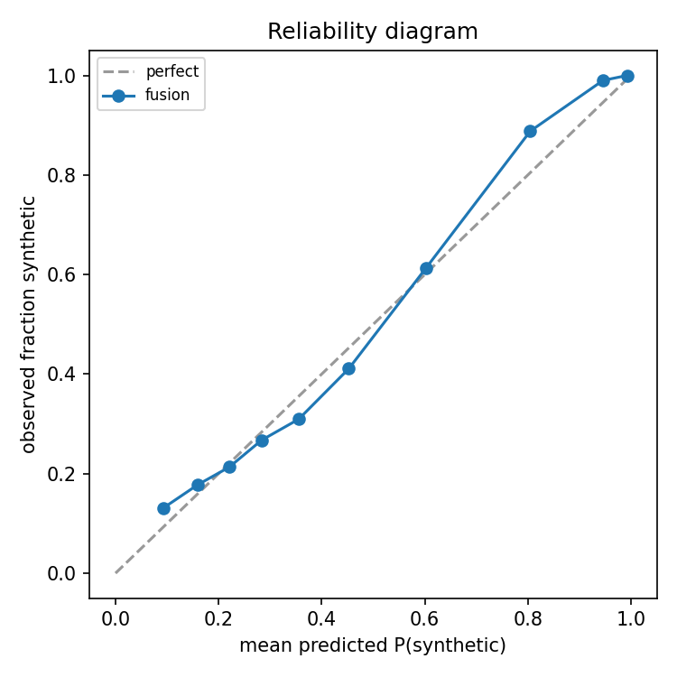
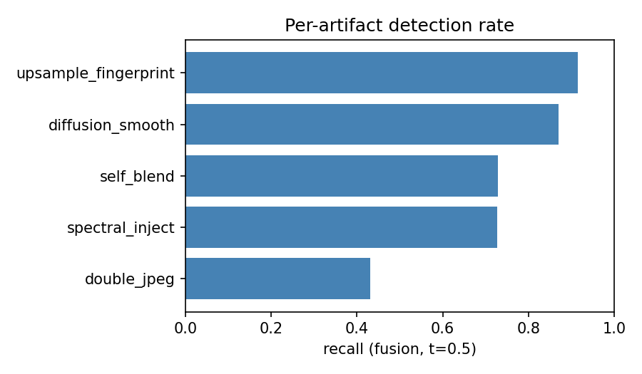

# Evaluation results

_Protocol: leave-source-out 5-fold GroupKFold (classifier=gboost, seed=0)_  
_Corpus: 160 images -> 7680 sources -> 61440 pseudo-samples (30720 real / 30720 fake)_

## Ablation (cross-validated out-of-fold)

| Model | AUC | AP | Acc | Precision | Recall | F1 | Brier |
|---|---|---|---|---|---|---|---|
| classical (fixed weights) | 0.457 | 0.453 | 0.510 | 0.507 | 0.733 | 0.599 | 0.275 |
| handcrafted | 0.853 ±0.003 | 0.884 | 0.785 | 0.849 | 0.693 | 0.763 | 0.149 |
| deep | 0.768 ±0.003 | 0.804 | 0.702 | 0.751 | 0.604 | 0.670 | 0.192 |
| fusion | 0.864 ±0.004 | 0.895 | 0.797 | 0.861 | 0.709 | 0.778 | 0.143 |

## Per-artifact recall (fusion)

| Artifact | Recall | n |
|---|---|---|
| double_jpeg | 0.431 | 9239 |
| spectral_inject | 0.727 | 9245 |
| self_blend | 0.729 | 9340 |
| diffusion_smooth | 0.870 | 9325 |
| upsample_fingerprint | 0.915 | 9050 |

## External validation (labelled test set)

| Metric | Value |
|---|---|
| auc | 0.329 |
| ap | 0.397 |
| accuracy | 0.492 |
| precision | 0.496 |
| recall | 0.980 |
| f1 | 0.658 |
| brier | 0.406 |

## Figures

